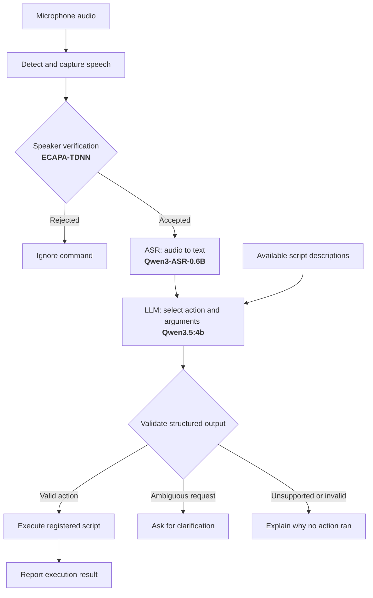

# AI Voice Assistant Project :
## GOAL : Design a user-specific voice assistant agent that can respond to audio commands.

## Baseline Pipeline: 

## Main Modules:
1. <b>Speaker Verification</b> : pre-trained model to enroll the user's voice and identify it for authorization,
2. <b>ASR Model</b>: pre-trained model to convert human speech to text.
3. <b>LLM</b> with structured outputs, tools, and guardrails to respond to the commands as needed.
4. <b>Evaluation Module </b>: to measure the performance of the overall assistant (pre-written tasks), the speaker verification (False Acceptance Rate, and False Rejection Rate), the ASR Module (Word Error Rate), Responsiveness (latency), and Resources.

## Checkpoints : 
1. [x] Specify the main modules.
2. Run the full pipeline on local machine successfully (no bugs).
3. The pipeline can now run a simple script from command.
4. Incorporate the Speaker Verification and test it.
5. The pipeline can add new tasks and respond to them. 
6. Run the full evals to measure and optimize the performance of the baseline.
7. Provide the UI for the pipeline.
8. Dockerize the project.
9. CI/CD integration 
10. Publish. 

## Downsides:
1. The speaker verfication contains high False Positives. And is prone to synthetic speaker imitation.
FIX: sweep different thresholds and test it on available datasets
