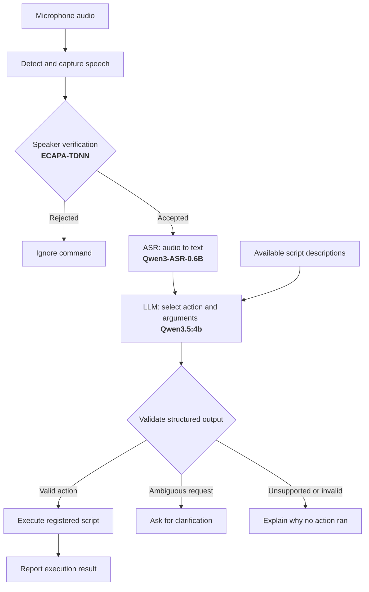

# AI Voice Assistant Project :
## GOAL : Design a user-specific voice assistant agent that can respond to audio commands.

## Baseline Pipeline: 

## Main Modules:
1. <b>Speaker Verification</b> : pre-trained model to enroll the user's voice and identify it for authorization.
2. <b>ASR Model</b>: pre-trained model to convert human speech to text.
3. <b>LLM</b> with structured outputs, tools, and guardrails to respond to the commands as needed.
4. <b>Evaluation Module </b>: to measure the performance of the overall assistant (pre-written tasks), the speaker verification (False Acceptance Rate, and False Rejection Rate), the ASR Module (Word Error Rate), Responsiveness (latency), and Resources.


## Checkpoints : 
1. Specify the main modules. - [x] 
2. Run the full pipeline on local machine successfully (no bugs). [x]
3. The pipeline can now run a simple script from command. [x]
4. Incorporate the Speaker Verification and test it. [x]
5. The pipeline can add new tasks and respond to them. 
6. Run the full evals to measure and optimize the performance of the baseline.
7. Provide the UI for the pipeline.
8. Dockerize the project.
9. CI/CD integration 
10. Publish. 


## Downsides:
1. The speaker verfication contains high False Positives. And is prone to synthetic speaker imitation.
<b>FIX</b>: sweep different thresholds and test it on available datasets.

2. The model records audio for fixed duration (10 seconds) and therefore is not dynamic.
<b>FIX</b>: Make dynamic-duration audio recording based on voice activity instead of fixed duration.


## LLM Agent:
### Capabilities:
1. Answer simple questions from memory without hellucination
2. Execute python/shell scripts
3. Write new scripts and add them to the tools list for future use
4. Remember user preferences and history among sessions.
5. Ask for clarification until the request is fully understood

### Limitations and guardrails:
1. Can't execute scripts that contain certain dangerous commands 
2. Can't access recent knowledge (offline)
3. 

### Persistent script tools

`src/tool_registry.py` provides `write_script_tool`, `search_scripts`, and
`execute_script` as LangChain tools. The baseline notebook uses these tools and
supports multiple tool-call rounds, including searching before executing a script.
Scripts live in `agent_generated_scripts/`; metadata persists in `tools/registry.json`.

```python
from src.tool_registry import ScriptRegistry, build_registry_tools

registry = ScriptRegistry()
tools = {tool.name: tool for tool in build_registry_tools(registry)}

entry = tools["write_script_tool"].invoke({
    "script_name": "multiply_values",
    "entry_point": "multiply_values",
    "source": '''def multiply_values(a: float, b: float = 2) -> float:
    """Multiply two numeric values."""
    return a * b
''',
})
if "error" in entry:
    raise ValueError(entry["error"])

# Review the saved source before enabling it. This method is not an LLM tool.
registry.enable_script(entry["id"])
result = tools["execute_script"].invoke({
    "script_id": entry["id"],
    "arguments": {"a": 3},
})
print(result)  # {"result": 6.0, "stdout": ""}
```

Entry points must be synchronous, undecorated functions with a docstring, typed
named parameters, and a return annotation. Supported annotations are `str`, `int`,
`float`, `bool`, `list[T]`, `dict[str, T]`, and unions such as `str | None`; `None`
is supported for functions without a result. Defaults must be JSON literals.
Function results must be JSON-serializable. Registration extracts metadata using
AST parsing without importing or running the source. It rejects duplicate tool
names and existing script files, locks concurrent writes, and atomically replaces
the registry JSON. An unsuccessful registry write removes the newly saved script.

New entries have `pending_validation` status. Enable a reviewed entry with
`registry.enable_script(id)`; its UUID is retained across sessions. Execution
checks the saved source hash, validates arguments, and calls the function in a
separate Python process with a ten-second timeout. A subprocess is not a sandbox:
enabled scripts retain the user's filesystem and network permissions. Static
syntax and schema checks do not establish that generated code is safe. Existing
metadata-only registry entries remain searchable but cannot execute until they
are registered with a source file under a unique name.

Run the registry tests without an LLM or model download:

```bash
venv/bin/python -m unittest discover -s tests -v
```

